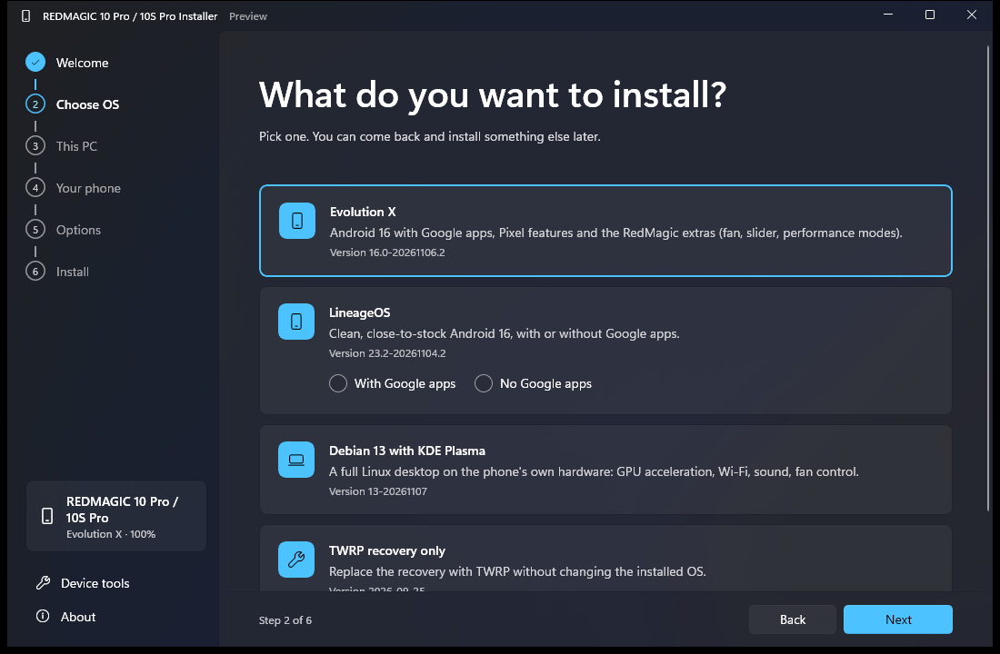
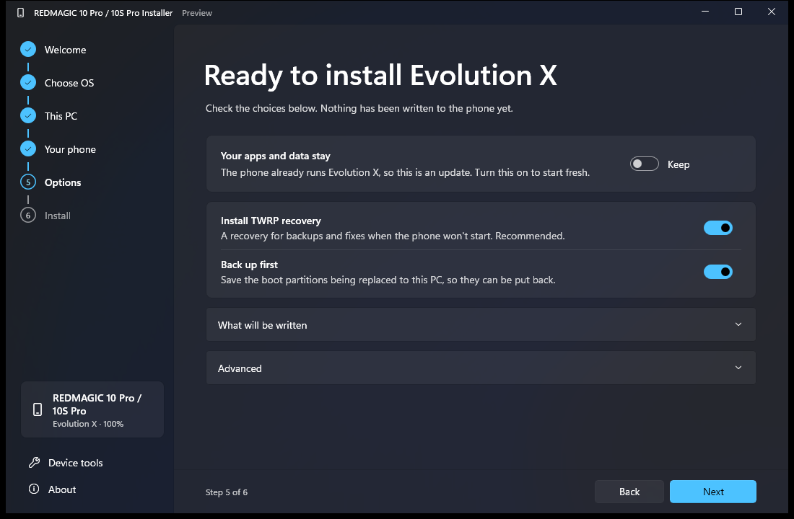
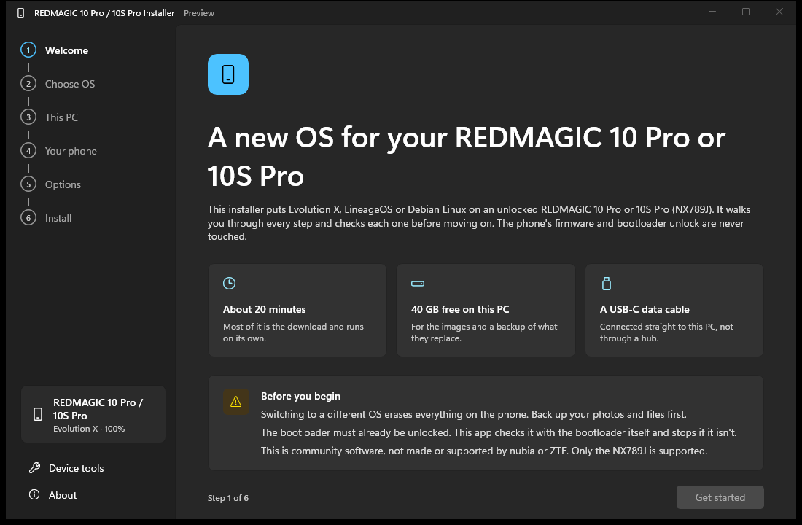
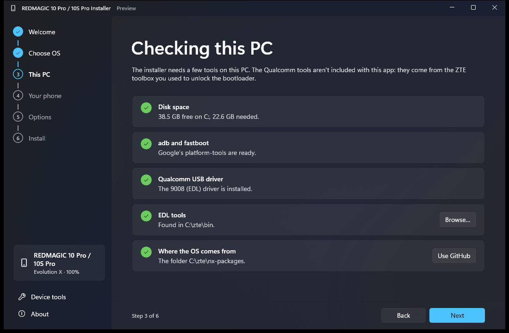
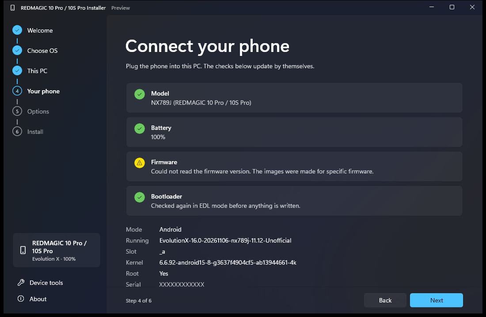
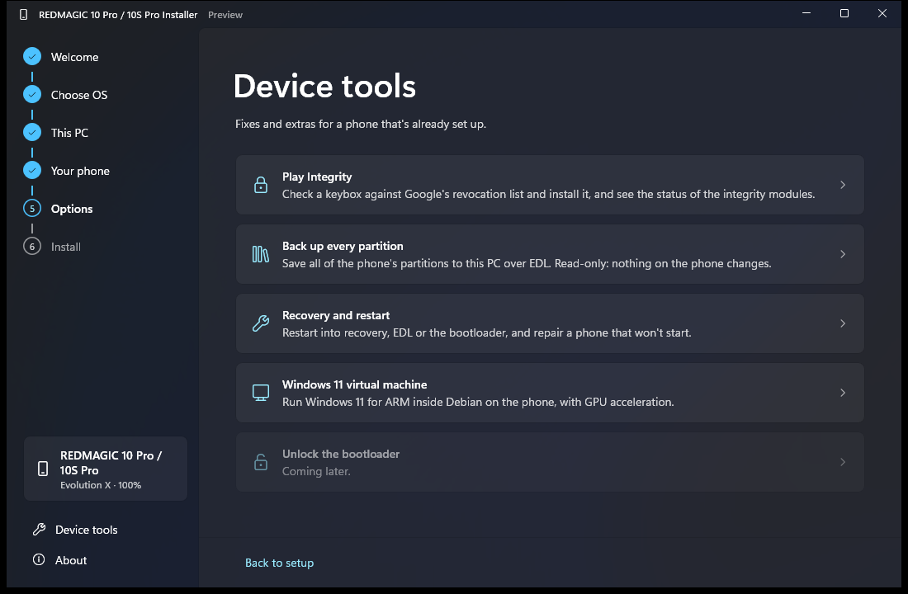
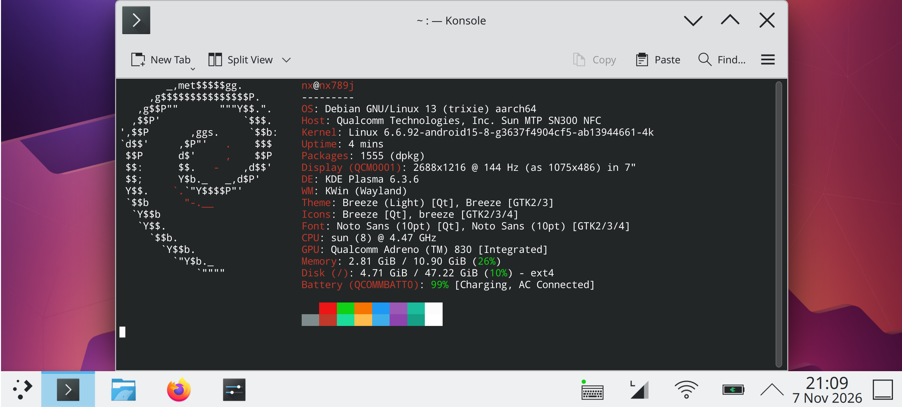
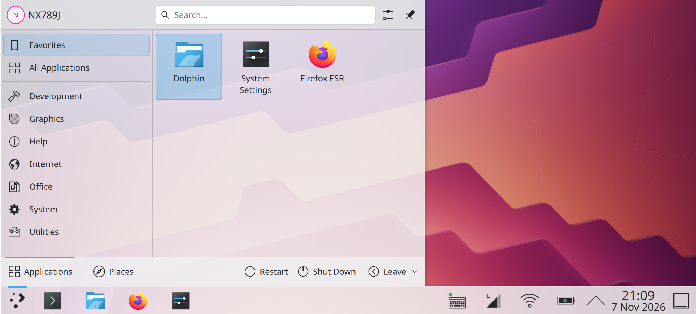
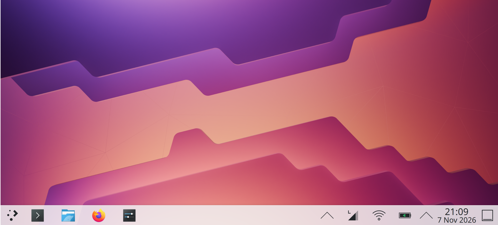

# NX789J Installer

A Windows 11–style installer for the ZTE nubia RedMagic 10 Pro and 10S Pro (both **NX789J**). It replaces the
loose collection of shell scripts with one guided app that installs an OS, checks every step, and
keeps the phone's firmware and unlock untouched.

> **Experimental.** Flashing erases what's on the phone. The bootloader must already be unlocked.
> Only the NX789J is supported; other models are refused.

<p>
  
  
</p>

## Getting started

### 1. Unlock the bootloader

The installer only works on a phone whose bootloader is already unlocked. The free unlock for
the 10 Pro / 10S Pro is the **ZTE Family Toolbox** (中兴家族工具箱) **1.2.8-beta4** by @SYXZ (某贼),
linked in
[this XDA thread](https://xdaforums.com/t/red-magic-11-pro-guide-bootloader-unlock-free-also-support-rm10-pad3pro-z70u-z80u-unlock-zte-family-toolbox.4780930/).
Follow the thread to unlock. Don't update the stock firmware to 11.0.13 or later first: the
thread reports that it blocks the unlock.

Keep the toolbox: the installer uses its Qualcomm EDL tools, which it can't ship itself.

### 2. Put the toolbox where the installer finds it

Unpack the toolbox so that its `bin` folder is at **`C:\zte\bin`** (so `C:\zte\bin\tool\Win\fh_loader.exe`
exists). The installer also looks in `C:\ztetoolbox\bin` and `C:\ZTEToolBox\bin`; anywhere else,
point it there with **Browse…** on the **This PC** page. It uses only these files from it:

| File | What it is |
|---|---|
| `bin\tool\Win\QSaharaServer.exe` | loads the EDL programmer onto the phone |
| `bin\tool\Win\qcedlcmdhelper.exe` | configures the EDL connection |
| `bin\tool\Win\fh_loader.exe` | reads and writes partitions |
| `bin\res\NX789J\devprg` | the NX789J EDL programmer (firehose) |

### 3. Install the Qualcomm 9008 driver

The phone is written in EDL mode (Qualcomm 9008), which needs Qualcomm's USB driver. The toolbox's
`刷机驱动和运行库.txt` ("flashing driver and runtime") links to it, plus the Visual C++ runtime if
a tool complains about a missing DLL. With the driver installed, a phone in EDL shows up in Device
Manager as **Qualcomm HS-USB QDLoader 9008 (COMn)**.

### 4. Get the installer and run it

Download `NxInstaller-<version>-win-x64.exe` from the
[latest release](https://github.com/devnotcc/nx789j-installer/releases/latest). It's a single
exe with nothing to install; Windows SmartScreen may warn because it isn't signed
(**More info → Run anyway**). adb and fastboot are downloaded from Google by the app itself.

On the phone, turn on **USB debugging** (Settings → System → Developer options) and allow this PC
when asked. Then connect it **straight to the PC** (no hub) and follow the steps:

| | |
|---|---|
|  | **Welcome**: what's needed. Tick the box once you've backed up the phone. |
|  | **Choose OS**: Evolution X, LineageOS (with or without Google apps), Debian or TWRP. |
|  | **This PC**: disk space, adb, the 9008 driver and the EDL tools. Everything must be green. |
|  | **Your phone**: model, battery (30% or more), firmware and bootloader. |
|  | **Options**: keep or erase data, TWRP, backup first, and a list of exactly what will be written. |

Then **Install**: the app restarts the phone into EDL, checks the unlock again from the
bootloader's own record, backs up the partitions it replaces to this PC, writes, reads everything
back, restarts the phone and checks it once it's up. Don't unplug the phone until it says it's done.

**Device tools** has a keybox checker and installer for Play Integrity, a full partition backup,
and restart/repair tools:



### Without the app

Each OS has a step-by-step manual install with the same EDL tools, in its own repo:
[Evolution X](https://github.com/devnotcc/nx789j-evox) ·
[LineageOS](https://github.com/devnotcc/nx789j-lineageos) ·
[TWRP](https://github.com/devnotcc/nx789j-twrp). Each repo also lists what works and what doesn't.

## What it installs

| Package | Status |
|---|---|
| **[Evolution X](https://github.com/devnotcc/nx789j-evox)** 16 (KernelSU-Next + SUSFS kernel, optional TWRP) | released, installed and in daily use on a phone |
| **[TWRP](https://github.com/devnotcc/nx789j-twrp)** recovery on its own | released |
| **[LineageOS](https://github.com/devnotcc/nx789j-lineageos)** 23.2, with or without Google apps | released, not yet tested on a phone |
| **Debian 13 + KDE Plasma** (on top of Evolution X or LineageOS) | released |

Evolution X 16.0-20261106.2 brings DTS speaker tuning that switches itself off while Bluetooth
audio is connected (the speaker tuning made earbuds thin), a louder media volume curve on the
speaker, VoLTE and call audio. Debian 13-20261106 adds **mobile data** with a tray icon: signal,
on/off, SIM 1 / SIM 2, and unlocking a PIN-locked SIM. Wi-Fi takes over when it's connected.

After writing, the installer reads every partition back and compares checksums. Then it waits
for the phone to start and checks what's running: the right OS and build, the slot and kernel
it wrote, SELinux, that apps and data are still there, and that the phone stays up instead of
restarting. After a Linux install it waits for systemd and the Plasma desktop.

<p>
  
</p>
<p>
  
  
</p>

### How the Linux install works

Debian runs next to Android on the same kernel: Android's native side keeps loading the
drivers, firmware and vendor services, and Debian (systemd in its own namespaces) takes the
screen. Evolution X's kernel already has what Linux needs (KernelSU, plus the namespaces and
device filesystem systemd uses), so a Linux install writes **no partition at all**:

1. The installer copies the Linux image, its launchers and a small **install agent** to
   `/data/local/tmp/nx-install` over adb, plus `firstboot.conf` (your Linux password as a
   SHA-512 crypt hash, never the password) and a manifest (name, size, SHA-256 of every file).
2. It runs the agent as root through KernelSU (so Shell needs superuser in the KernelSU app).
   The agent takes the upload out of the adb user's reach, checks every file against the
   manifest, accepts only a fixed list of names, refuses symlinks and hard links, never
   replaces an installed Linux unless asked, moves the files into `/data/nx-linux`, grows the
   image to the chosen size, and installs a KernelSU boot hook. It reports `ok` or the reason.
3. The installer sets the boot mode and restarts into Linux. Debian sets the password, grows
   its filesystem and makes its SSH host keys on the first start (about 3 minutes with a black
   screen); later starts take about a minute.

Android's apps, data, root and Play Integrity stay, and Android keeps SELinux enforcing.
The screen rotates with the phone in Linux too, and the panels switch between a portrait and a
landscape layout.

- **Bluetooth** works in Debian, including headphones. Since 13-20261109 devices paired in
  Android connect in Debian without pairing again and keep working in Android. Pair new devices
  in Android: a device paired in Debian works only in Debian until it's paired again in Android
  (both systems use the same Bluetooth address).

## Source code

| Repository | What |
|---|---|
| [android_device_nubia_nx789j](https://github.com/devnotcc/android_device_nubia_nx789j) | device tree, plus every change to Evolution X source (`patches/evox`) and its pinned manifest |
| [android_vendor_nubia_nx789j](https://github.com/devnotcc/android_vendor_nubia_nx789j) | proprietary blobs from RedMagicOS 11.0.4 |
| [android_kernel_nubia_nx789j](https://github.com/devnotcc/android_kernel_nubia_nx789j) | the kernel in the Evolution X package (GKI 6.6.92 + KernelSU-Next + SUSFS) |
| [nx789j-linux](https://github.com/devnotcc/nx789j-linux) | the Debian 13 + KDE Plasma image: build scripts, overlay, phone-side files |

## Toolbox

- **Play Integrity** — check a keybox against Google's revocation list, install one (no reboot),
  and see the status of the modules on the phone. **The app never ships keyboxes; you provide your own.**
- **Full backup** — read every partition over EDL to the PC, with checksums (read-only).
- **Recovery** — restart into recovery/EDL/bootloader; fix a phone that only starts into fastboot
  (clears the bootloader's "unbootable" mark in both copies of the partition table); put the
  kernel back (rewrites only boot + init_boot from an OS package, keeps data).
- **Windows 11 VM** — set up the crosvm-based Windows guest on a Debian install.

## Safety

- **Firmware is never written.** The bootloaders, TrustZone, modem, DSPs, and the partitions that
  hold the bootloader unlock and radio calibration are on a hard deny-list in the engine
  (`PartitionPolicy`), checked again right before every write, whatever a package asks for.
- **The unlock is verified from the bootloader itself** (the `devinfo` partition) in EDL before
  anything is written — not from Android, which custom ROMs spoof to "locked".
- Installs **back up the partitions they replace** to the PC first, then **read them back and
  compare checksums** after writing (in 1 GiB pieces, so a USB hiccup costs one piece).
- **Data is never erased by guesswork.** When the phone is already in EDL mode the installer can't
  see which system it runs, so it asks: an update keeps your data, otherwise you confirm the erase.
  On the command line, `--keep-data` or `--wipe` is required in that case.
- If an install is interrupted and the phone stays stuck in EDL mode (black screen), unplug it and
  hold **Power + Volume Up + Volume Down** for about 20 seconds.
- Nothing is written below 30% battery, or with more than one phone connected.

## Layout

```
src/NxInstaller.Core   engine: device detection, EDL, packages, install, backup, Play Integrity, safety
src/NxInstaller.Cli    nxcli — the engine on the command line (testing and scripting)
tests/                 unit tests for the safety-critical logic
```

A WinUI 3 app (the wizard in the screenshot) sits on top of the same engine.

## Tools it needs

- **adb / fastboot** — downloaded from Google automatically.
- **Qualcomm EDL tools + the NX789J firehose** — these are proprietary and are **not** shipped;
  the app finds them in the ZTE toolbox you already have from unlocking the bootloader.
- **OS images** — downloaded from GitHub Releases (large ones split into parts and rejoined), or
  from a local folder / USB drive.

## Command line

```
nxcli probe                 show the connected phone
nxcli checks                run the pre-install checks
nxcli keybox <file>         check a keybox against Google's revocation list
nxcli pif-status            show the Play Integrity stack on the phone
nxcli pif-swap <file>       check then install a keybox (no reboot)
nxcli edl-info              EDL lock state + partition count (read-only)
nxcli backup [dir]          full partition backup over EDL (read-only)
nxcli install <id> [--dry-run] [--twrp] [--wipe | --keep-data] [--source dir] [--no-check]
            Linux: [--size GB] [--replace] [--stay-android] [--password-file f]
nxcli repair-slot [--dry-run]   clear the "unbootable" mark on the active slot (phone in EDL)
nxcli kernel <id> [--dry-run] [--no-check]   rewrite only boot + init_boot from a package
nxcli pack <spec.json> <dir>    build a package: zstd, split under 2 GiB, manifest.json
```

## Building

```
dotnet test tests/NxInstaller.Core.Tests
dotnet publish src/NxInstaller.App -c Release -r win-x64 -p:Platform=x64 -o artifacts/NxInstaller-win-x64
```

The release build is one trimmed, compressed exe (about 58 MB). Package specs for `nxcli pack`
are in `packaging/`.

## License

GPL-3.0-or-later (see [LICENSE](LICENSE)). The Qualcomm EDL tools, firehose loader, Google
platform-tools, OS images and keyboxes the app works with are not part of this repository and
keep their own terms.
